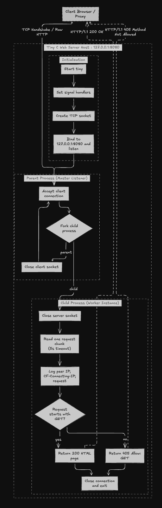

<div align="center">

<h1><code>Tiny C Web Server</code></h1>

<samp>A small, loopback-only HTTP server built to learn how a web server works.</samp>

<br />


</div>

<br />

<p align="center"><samp>ʟᴇᴀʀɴɪɴɢ ᴘʀᴏᴊᴇᴄᴛ · ꜰᴏʀᴋ-ᴘᴇʀ-ᴄᴏɴɴᴇᴄᴛɪᴏɴ · ᴜꜱᴇʀ-ʀᴜɴ ʟᴏᴄᴀʟʟʏ</samp></p>

## <samp>› a tiny server, end to end</samp>

Tiny is a small C web server for learning how an HTTP request moves through a server. It binds only to `127.0.0.1:8080`, accepts a connection, and forks a short-lived worker to handle it.

The worker reads one request chunk with a five-second timeout and logs a sanitized request line. `GET /` serves the personal landing page, and `GET /noise-14-mono.jpg` serves its background image. Unknown paths return `404`; other methods receive `405 Method Not Allowed`. Each connection closes after the response.

---

<table>
<tr>
<td width="620" valign="middle" align="center">

</td>
<td width="58%" valign="middle">

<h2><samp>› run it</samp></h2>

<p>Requires a C compiler and <code>make</code>.</p>

<pre><code>make
./tiny</code></pre>

<p>Open <a href="http://127.0.0.1:8080">127.0.0.1:8080</a>, or check both response paths:</p>

<pre><code>curl -i http://127.0.0.1:8080/
curl -i -X POST http://127.0.0.1:8080/</code></pre>

<p>Stop the server with <code>Ctrl+C</code>.</p>

<hr />

<h2><samp>› build options</samp></h2>

<p>The Makefile enables compiler warnings, stack protection, and position-independent code. Linux builds also enable RELRO linker hardening. macOS skips Linux-specific linker flags.</p>

<p>Optional sanitizer build:</p>

<pre><code>cc -g -O1 -Wall -Wextra \
  -fsanitize=address,undefined \
  -fno-omit-frame-pointer \
  -o tiny-asan tiny.c
./tiny-asan</code></pre>

</td>
</tr>
</table>

## <samp>› Fedora systemd</samp>

The included `tiny.service` runs as a dynamic unprivileged user in a systemd sandbox. After building on Fedora:

```bash
sudo install -d -m 0755 /usr/local/share/tiny/assets
sudo install -m 0755 tiny /usr/local/share/tiny/tiny
sudo install -m 0644 index.html /usr/local/share/tiny/index.html
sudo install -m 0644 assets/noise-14-mono.jpg /usr/local/share/tiny/assets/noise-14-mono.jpg
sudo install -m 0644 tiny.service /etc/systemd/system/tiny.service
sudo systemctl daemon-reload
sudo systemctl enable --now tiny
systemctl status tiny
```

---

## <samp>› network boundary</samp>

The server binds only to `127.0.0.1` and serves the landing page and its background image. For public access, use a Cloudflare Tunnel and keep port `8080` closed at the router.

## <samp>› limits and deployment</samp>

This is a learning project, not a general-purpose HTTP server. It supports IPv4 and `GET`, reads only one request chunk, serves only the landing page and its background image, closes each connection, and forks per connection. It should stay on loopback. The server trusts `CF-Connecting-IP` only for logging, so use that value only when the tunnel is the sole route to the server.

<p align="center"><samp>C · POSIX sockets · HTTP · systemd</samp></p>
